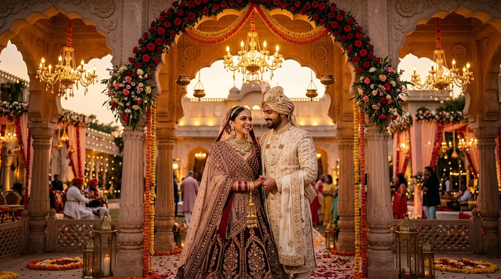

# 🌸 Royal Indian Wedding Invitation Website

A luxurious, culturally rich, and interactive Indian wedding invitation website designed with a royal maroon, cream, and gold color palette, traditional Indian floral motifs, and festive animations.



## ✨ Key Features

### 1. 👑 Royal Hero Section
- Auspicious Vedic Shloka: `॥ श्री गणेशाय नमः ॥`
- Heading: **"Together with Our Families"**
- Title: **"Wedding Invitation"**
- Bride's and groom's names prominently presented in golden calligraphy
- Auspicious wedding date badge
- **Live Countdown Timer** calculating days, hours, minutes, and seconds until the sacred pheras
- Regal palace arch illustration with glowing lanterns and floral garlands
- *"Explore Our Wedding Invitation"* smooth-scroll button

### 2. 💌 Traditional Wedding Invitation Card
- Auspicious invocation: `॥ वक्रतुण्ड महाकाय सूर्यकोटि समप्रभ ॥`
- Warm invitation message:
  > *"With immense joy and the blessings of our families, we cordially invite you to celebrate the wedding of our beloved couple. Your presence and blessings will make this special occasion even more memorable."*
- Double gold borders, traditional corner flourishes, and wax seal stamp (`S ♥ A`)
- Editable placeholders for bride's name, groom's name, parent titles, and family signatures

### 3. 🪔 Wedding Events & Ceremonies
- Beautiful individual cards for each ceremony:
  - 💛 **Haldi Ceremony:** Turmeric celebration & phoolon ki holi
  - 💚 **Mehendi & Sangeet:** Henna art, dhol beats & musical performances
  - ❤️ **Wedding Ceremony (Shubh Vivah):** Baraat procession & sacred Vedic pheras
  - 💜 **Royal Reception:** Gala dinner & banquet celebration
- Dynamic event management: **Add, Edit, or Remove ceremonies**
- **"Add to Calendar":** One-click download of `.ics` calendar invite for any ceremony

### 4. 📍 Wedding Details & Directions
- Comprehensive celebration overview (bride, groom, wedding date, reception date, venue)
- Family blessing quote
- **"Get Directions" Button:** Opens Google Maps route directly to the venue
- Embedded interactive Google Map preview

### 5. 📸 Couple Photo Gallery
- Responsive photo grid with smooth hover zoom effects and category filters (*All, Pre-Wedding, Haldi, Mehendi, Wedding, Reception*)
- **Upload Photographs:** Direct photo upload button to add personal pictures into the album
- **Full-Screen Lightbox:** Modal preview with Next, Previous, and keyboard arrow navigation

### 6. 💖 Interactive RSVP & Blessings Wall
- **Interactive RSVP Form:** Collects guest name, contact, guest count, attending ceremonies, dietary preferences (*Rajasthani Feast, Jain Vegetarian, Pure Vegetarian, Vegan*), and personal notes
- **Celebration Burst:** Generates a shower of flower petals upon RSVP confirmation
- **Blessings Guestbook Wall:** Guests can leave heartfelt blessings, select reaction badges, and give heart reactions

### 7. 🎶 Cultural Ambiance & Audio
- **Web Audio API Shehnai Synthesizer:** Authentic classical Indian Shehnai & Tanpura melody (*Raag Yaman / Mangal Dhwani*) with zero external dependencies (100% offline-ready)
- **Floating Controls Stack:**
  - Music toggle button with animated soundwaves
  - Flower petals shower toggle (rose and marigold petals)
  - Quick customizer drawer
  - WhatsApp share button
- **Live Customizer Modal:** Real-time form to update all names, dates, venues, and messages with `localStorage` persistence

---

## 🚀 Running Locally

You can run the website using Python's built-in HTTP server:

```bash
# Clone the repository
git clone https://github.com/26vvcecse0405-sys/wedding-invitation.git

# Navigate into the project folder
cd wedding-invitation

# Start local server
python -m http.server 8080
```

Now open **[http://localhost:8080](http://localhost:8080)** in your browser!

You can also simply double-click `index.html` to open it directly in any modern browser.

---

## 🛠️ Project Structure

```
├── index.html              # Main HTML5 structure & SEO metadata
├── css/
│   └── style.css           # Royal maroon, cream & gold styling, animations, responsiveness
├── js/
│   ├── app.js              # State management, countdown timer, event manager, gallery, RSVP
│   └── audio.js            # Web Audio API Indian Shehnai synthesizer
└── assets/
    └── images/
        └── hero_wedding.jpg# 8K Royal Indian wedding couple hero photo
```

---

## 📝 Customization

1. **Via UI:** Click the **"Edit Details"** button in the navbar or the floating slider button to open the **Quick Customizer**. Changes are automatically saved.
2. **Via Code:** Edit the `DEFAULT_WEDDING_DATA` object at the top of `js/app.js` to change default names, dates, ceremonies, and venue addresses.

---

## 📜 License
Created with ❤️ for a royal family wedding celebration. Feel free to use and customize for your own wedding celebrations!
